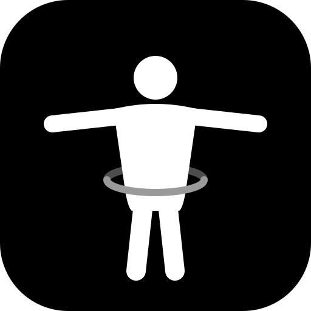

# Fabric — phone body scan



**Fabric Body Scan** measures a body with a phone camera: arms out, one walk around, and 11 girths and 8 lengths, computed on the device. No frames are uploaded.

**Open it on your phone: <https://timcash.github.io/fabric/>.** Then install it to the home screen:

- **Android Chrome:** tap **Install** on the page, or use menu → Install app.
- **iPhone Safari:** tap Share → Add to Home Screen.

Installed, it opens full screen in portrait and works offline. The pose model is cached after the first scan.

Fabric started from [timcash/template](https://github.com/timcash/template) (Vite + TypeScript + Three.js, copied at `be59c4f`). The scanner is the home page ([index.html](index.html)); the template's slide deck lives at [deck.html](deck.html).

```sh
npm ci
npm run dev      # also fetches the pose model into public/mediapipe/
# open http://127.0.0.1:5173/  (a phone needs https: deploy, or tunnel the dev server)
npm run test:sim # simulated scan of a 3D body, scored against the mesh, recorded as a video
```

**Simulate a scan (3D body)** runs the whole app on a rendered CC0 human mesh in a furnished room, with a helper walking around, instead of the camera. Use `/?sim=1`; add `&detector=oracle` for exact masks or `&scenario=turn` for the turn-on-the-spot setup.

### Installable app (PWA)

| Piece | What it does |
| --- | --- |
| [public/manifest.webmanifest](public/manifest.webmanifest) | Name "Fabric Body Scan" (home screen: "Fabric Scan"); opens `fullscreen`, falling back to `standalone`; portrait; dark theme; regular and maskable icons; a "Simulate a scan" shortcut. |
| [scripts/service-worker.ts](scripts/service-worker.ts) | Generated into `sw.js` at build time. It precaches that build's exact hashed files and the icons, network-first for pages so new deploys show up, and caches the MediaPipe runtime, model and simulation mesh on first use for offline scans. |
| [src/scan/pwa.ts](src/scan/pwa.ts) | Registers the worker and offers **Install** (Android/desktop Chrome) or the Share → Add to Home Screen hint (iOS). During capture it requests fullscreen, locks portrait and keeps the screen awake. |
| [public/brand/](public/brand) | The logo: a T-pose figure, the app's scan pose, with a tape ring at the waist. Includes 192/512, maskable and Apple touch icons, and a share card. `scripts/make-icons.ts` re-renders the PNGs from the SVGs. |

On phones the capture screen fills the display. The guidance sits above the camera and the controls below it, so the whole frame, head to feet, stays visible. The layout respects notch and home-bar safe areas.

## How a scan works: arms out, the whole time

1. **Setup:** enter your height; it sets the metric scale. Choose how you'll scan:
   - **A helper walks around you with the phone** (recommended).
   - **Prop the phone and turn on the spot.**
   - **Quick: front and side only.**
2. **Front:** the subject faces the camera with **both arms straight out to the sides at shoulder height, palms down**, feet hip-width apart, about 2.5 m away. Live checks cover body detected, framing, facing, arms out, feet, stillness and phone level. When all pass, a countdown captures six frames and takes their median.
3. **Walk around (or turn):** the helper walks one slow circle around the still subject, keeping them head to feet in frame. Without a helper, the subject turns on the spot in front of a propped phone instead.
   - Every frame is **leveled with the phone's gravity sensor**: a pure rotation about the lens.
   - Every frame gets its **own metric scale** from the subject's height, so the phone's distance, height and wobble don't matter.
   - Each frame gives caliper widths from one angle: the torso at the chest, waist and hip, and each leg wherever the legs separate. It also gives an estimate of **where the camera was**: its angle around the subject, distance and height.
   - Frames with the arms down are shown but never measured. A dial shows how much of the circle is covered.
4. **Results:** 11 girths and 8 lengths, each with its method and an expected ±. The page also shows a 3D cross-section view and annotated front and profile frames. You can export CSV or JSON, or a **capture package** (frames, person masks, landmarks and scale) for offline photogrammetry or Gaussian-splat training.

Why arms out: held at shoulder height, the arms never cross the chest, waist or hip levels from any angle. With arms down or in an A-pose, they merge with the torso outline at oblique angles and inflate the girths.

| Measurement | Method |
| --- | --- |
| Chest, waist, hip, thigh, knee, calf, ankle | **Turntable:** caliper widths by angle integrated with Cauchy's formula, P = ∫₀^π w(θ) dθ. This is the convex outline a tape follows, with no ellipse assumed. Legs are read where they separate, and each leg uses its own hip/knee/ankle landmarks to correct for perspective as it swings nearer or farther. Leg depth comes from the near-profile overlap. Falls back to two-view, then to front-only estimates. |
| Neck, wrist | Front width and a typical cross-section ratio (arms out hide their depth from every angle). |
| Upper arm, forearm | Perpendicular limb width, circular section. |
| Arm span, inseam, shoulder–crotch, waist height | Silhouette distances. |
| Shoulder span, arm length, hip-joint height, torso length | Pose-landmark distances. |

How it is built: MediaPipe Pose Landmarker (33 landmarks plus a person mask) runs in WebAssembly and WebGL. The floor is taken at the heels with a parallax correction, because toes pointing at the camera reach lower in the image. That reach is worth about 4% of scale. The front view's floor and scale carry to every turn frame. Plausibility gates reject merged silhouettes, bent arms and a lost crotch instead of reporting nonsense.

### Moving-camera scans, and NVIDIA MetricTrail

[NVIDIA MetricTrail](https://huggingface.co/nvidia/MetricTrail) (model card dated 11/05/2026) estimates **metric camera motion and per-frame metric depth from a monocular RGB sequence**. It combines a single-image metric-depth model (MoGe-2), learned sparse correspondences (DPVO with a DINOv3 encoder), and local bundle adjustment. It can't run in this app:

- It needs a CUDA GPU.
- Its checkpoint is "released separately" (not yet available).
- Its licence limits it to non-commercial research.
- It has no browser build.
- The card notes it uses no dynamic-object handling.

The walk-around mode borrows its central idea: **re-anchor metric scale in every frame from a metric prior, and recover the camera's motion**. Here the prior is the subject's known height plus the phone's gravity vector. That is exactly enough for this problem: the subject stands still, and the measurements only need each frame's metric scale, floor line and viewing angle. A static subject also makes the capture what visual odometry expects: a static scene filmed by a moving camera. So the capture package (frames, masks, per-frame camera estimates, gravity, intrinsics guess) is ready for offline reconstruction with MetricTrail, COLMAP/GLOMAP or MASt3R/VGGT, and Gaussian splatting.

## Simulation: a 3D body as ground truth

[`src/sim/`](src/sim) poses the **CC0 MakeHuman base mesh** ([public/sim/makehuman](public/sim/makehuman)) with its CC0 skeleton and skin weights. It straightens the elbows and raises the arms to a T with linear blend skinning. A pinhole phone camera (portrait, 66° field of view, 2.5 m away, 1 m high) renders it as "photos". The app's own pipeline then scans it: front frame, then one full turn. Ground truth is the posed mesh sliced where the app measured (each chord's image row is back-projected through the camera), measured like a tape: the convex hull of the cross-section.

- `npm test` includes [test/sim-makehuman.test.ts](test/sim-makehuman.test.ts). It uses exact masks and joints from a software rasterizer across five setups: camera at 70, 100 and 130 cm; 2.5–3 m; 66–72° field of view; and body shapes ×0.85 to ×1.25 in girth.
- `npm test` also covers the walk-around with exact masks and joints ([src/sim/path.ts](src/sim/path.ts)). The handheld phone's distance (±2 cm), height (±6 cm with walking bob), aim (±3°), pitch (−3 ± 3°) and roll (±3°) wander, and the gravity reading has 0.4° of noise.
- `npm run test:sim` renders the scene with three.js in Chrome: the subject stands in a **furnished room** ([src/sim/room.ts](src/sim/room.ts)) while **a helper, a second MakeHuman body holding the phone, walks around them**. It runs **the real MediaPipe model on every rendered frame** through the actual app UI. It writes to `test-results/body-scan-sim/`:
  - `body-scan-simulation.mp4`: setup → front capture → walk-around (with a cut-away view of the room, helper and phone) → results, with mesh truth, the true mesh under the measured rings, and the estimated vs true camera path.
  - `photos/`: rendered photos from the helper's walk every 45°.
  - `report.md` and `report.json`: measured vs mesh truth and camera-path error. These cover MediaPipe on the walk-around, and the oracle on both the walk-around and the turn-on-the-spot scenarios.

Latest run (166.6 cm body; MediaPipe figures vary a little between runs):

| | Chest | Waist | Hip | Thigh | Knee | Calf | Ankle | Neck | Upper arm | Inseam | Camera path |
| --- | ---: | ---: | ---: | ---: | ---: | ---: | ---: | ---: | ---: | ---: | --- |
| Walk-around, MediaPipe in the room | +0.9% | +1.9% | +2.7% | +4.1% | −0.3% | +0.3% | +2.1% | +14% | +0.9% | −3.6 cm | 4.4° angle, 1.5 cm height, 5 cm distance |
| Walk-around, oracle | +0.2% | +0.1% | −0.1% | +1.2% | −1.1% | −1.8% | −3.4% | +1.8% | +0.8% | −1.5 cm | 0.5° angle, 1.0 cm height, 10 cm distance |
| Turn on the spot, oracle | −0.7% | −0.4% | −0.4% | +1.1% | −1.4% | −1.7% | −3.5% | +0.7% | +4.4% | −1.3 cm | |

The oracle rows isolate the geometry: perspective, leveling, the walk and the girth formula. The MediaPipe row adds the ML model's segmentation and landmark error against a cluttered room. Its mask runs slightly wide.

The front-only neck estimate is the weakest number, especially from a handheld front view at chest height. Across runs the walk-around oracle's chest has ranged from −4% to 0% and its neck from +2% to +16%: with arms out, this body's chest girth changes about 1.7 cm per centimetre of height just below the armpits, so the exact front frame chosen matters. Torso levels in walk-around frames are placed between that frame's own shoulder- and hip-joint landmarks, which keeps that spread small.

Camera distance is the least certain part of the path. It assumes a typical 68° phone lens, while the simulated lens is 66°; MetricTrail estimates the intrinsics instead. Only the camera path depends on that lens guess; the measurements don't.

A rendered mannequin is not a person in clothes, so real-world error will be larger. The tape-measure validation in [docs/body-scan-research.md](docs/body-scan-research.md) is still to do.

| Path | Purpose |
| --- | --- |
| `src/scan/measure.ts` | Front/profile silhouette anthropometry, heel floor and parallax, plausibility gates, multi-frame median |
| `src/scan/turntable.ts` | Turn and walk-around frames: per-frame scale, yaw, camera estimate and path, torso and per-leg widths by angle, Cauchy girth |
| `src/scan/rectify.ts` | Levels a handheld frame with the phone's gravity reading (mask and landmarks) |
| `src/scan/geometry.ts`, `mask.ts` | Ellipse/Cauchy perimeters; sub-pixel runs, chords, connected vertical extent |
| `src/scan/quality.ts` | Live capture checks, including arms out |
| `src/scan/pose-mediapipe.ts`, `feeds.ts` | Self-hosted MediaPipe, camera feed, tilt |
| `src/scan/main.ts`, `index.html`, `scan.css` | Capture flow and results UI |
| `src/scan/pwa.ts`, `public/manifest.webmanifest`, `scripts/service-worker.ts` | Installable app: install prompt, fullscreen and wake lock, offline cache |
| `src/scan/view3d.ts`, `capture-package.ts` | 3D cross-sections (with the true mesh in simulation); zip export for splatting |
| `src/scan/synthetic.ts` | Orthographic parametric body for fast geometry unit tests |
| `src/sim/makehuman.ts`, `camera.ts`, `truth.ts`, `compare.ts` | Mesh loading and posing, pinhole camera and rasterizer, mesh slicing, scoring |
| `src/sim/sim-feed.ts`, `observe.ts` | three.js render feed (MediaPipe or oracle; room + helper, or turn) and exact observations |
| `src/sim/room.ts`, `path.ts` | The furnished room; the helper's handheld walk and gravity-sensor noise |
| `scripts/sim-oracle.ts`, `scripts/sim-video-test.ts` | Node simulation; recorded browser simulation |
| `scripts/scan-browser-test.ts` | Phone-size browser test under the production CSP: installable app and offline shell, simulated scan, photo mode on rendered photos, fake camera |
| `scripts/prepare-pose-assets.ts` | Copies the WASM runtime and downloads `pose_landmarker_full.task` (runs before dev/build) |

**Run it on a phone.** The camera needs https, so pick one of these:

- **GitHub Pages:** live at <https://timcash.github.io/fabric/>. [.github/workflows/pages.yml](.github/workflows/pages.yml) builds with `BASE_PATH=/<repo>/` on every push to `main` or `body-scan` and publishes `dist/` to the `gh-pages` branch. If Pages isn't on, set Settings → Pages → Source to *Deploy from a branch*, branch `gh-pages`, folder `/`.
- **Cloudflare:** rename the Worker in `wrangler.jsonc` if you like, then run `npm run deploy`. `public/_headers` allows `camera=(self)` and `'wasm-unsafe-eval'`; everything else stays `'self'`.
- **Local:** run `npm run dev -- --host` and reach it through an https tunnel. Plain-http LAN addresses get no camera.

---

# Template — recursive nodes (inherited)

A reusable Vite + TypeScript + Three.js presentation with five example slides. The UI has one domain object: **Node**. Slide mode presents the five root examples in order; DAG mode explores nodes and their connections.

## Domain language

Use this vocabulary in visible instructions, code, hotkeys, and test assertions. **Workplane, container, card, and slide are not separate graph entities.**

| Term | Definition |
| --- | --- |
| **Node** | One item with an ID, title, content, color, a parent, children, and links between its children. Every node has the same capabilities. |
| **Root node** | The single node whose parent is null. Every other node belongs beneath it. The app starts inside Root, showing its five example children. |
| **Parent / child** | A containment relationship: the child lives inside its parent. Each non-root node has exactly one parent. |
| **Sibling** | A node with the same parent as another node. |
| **Interior** | The flat 2D plane displayed when a node is open. It shows that node’s direct children arranged as a DAG. It is a view, not another stored object. |
| **Open node** | The node whose interior is currently displayed. Its ID determines the editing context. |
| **Selected node** | The child targeted by focus, open, color, delete, or dependency-navigation actions. Selection is not the same as the open parent. |
| **Dependency link** | A directed connection between siblings. A link means “depends on,” not “is contained inside.” Links cannot form cycles. |
| **DAG** | The acyclic graph of one parent’s direct children and their dependency links. The same rule applies at every nesting depth. |
| **Rank / lane** | A dependency column / a row within that column. Automatic layout assigns non-overlapping cells on the parent’s plane. |
| **Depth** | How many parent-child boundaries have been opened below Root. It is not a camera distance or a detail level. |
| **Breadcrumb** | The containment path from Root to the open node. Clicking an ancestor returns inside it. |
| **Slide mode** | The sequential presentation of the five root examples. Nested content uses the same node hierarchy; Present returns to its owning root example. |
| **DAG mode** | The spatial view of the open node’s children, using the same Three.js renderer and canvas. |
| **Editable example** | The nodes inside Root → Interact → Editable graph, also shown on the Interact slide. These are the same data objects in both views, not a second graph. |

### The one rule

**Open any node → show its direct children as a DAG on a flat plane → select and open any child → repeat.**

An empty node opens to an empty plane. C creates its first child there. Nothing new is stored merely because a node was opened: an interior is the node’s view. A newly created child can immediately be opened and populated the same way.

There is no configured nesting-depth limit. Lookup and snapshot traversal are iterative, and tests exercise 512 successive opens. “Unbounded nesting” describes the model, not infinite browser memory; practical limits still depend on the device.

### Example hierarchy

```text
Root                            parent: null
├── Welcome
├── Navigate
├── Interact
│   ├── Editable graph
│   │   ├── Node 1
│   │   ├── Node 2
│   │   └── …                   each can contain another DAG
│   └── Edit the graph
│       ├── Create
│       │   └── Your new node
│       │       └── Another node
│       ├── Change color
│       └── Remove
├── Playback
└── Make it yours
```

The root’s dependency links branch from Navigate into Interact and Playback, then join at Make it yours. Those links do not change containment. **L follows a dependency; N opens a child; T returns to the parent.**

## Three zoom levels

Only one representation of each visible node is rendered at a time:

| Level | Representation | Use |
| --- | --- | --- |
| **Point** | A compact point and connections | Read the whole graph’s shape. |
| **Summary** | The node’s title | Identify and select a node. |
| **Full content** | Title, description, child count, and the same live 3D scene shown in Slide mode | Inspect the slide’s content; N opens its child DAG. |

Zoom changes representation, not the hierarchy. **N** or double-click opens the selected node’s child DAG; **Enter** only focuses it. Child node centers all lie on the same local plane. Ancestor layers are not stacked over the current graph. The plane is rendered by Three.js and can still be orbited.

## Actions and hotkeys

The executable catalog is [src/hotkeys.ts](src/hotkeys.ts). The guide renders that catalog, and tests verify that every binding resolves to its documented action.

| Context | Action | Hotkey / gesture |
| --- | --- | --- |
| Both | Switch Slide / DAG presentation | G or / |
| Both | Open guide and hotkey reference | ? |
| Both | Start / stop Controls walkthrough | W / Tour button |
| Both | Stop walkthrough or story; close an open guide | Escape |
| Both | Open the selected node’s child DAG | N / double-click in DAG |
| Both | Return to parent node | T |
| Both | Create inside the currently open parent | C |
| Both | Recolor selected node | X |
| Both | Remove a created node, its descendants, and incident links | Delete / Backspace |
| Both | Orbit clockwise / counterclockwise | O / Shift+O; drag |
| Both | Reset camera / frame the currently open node | R |
| Slides | Previous / next root example | ↑ / ↓; ← / → and PageUp / PageDown are aliases |
| Slides | First / last example | Home / End |
| Slides | Invoke the visible action button | Enter |
| Slides | Start / pause Story playback | Space |
| Interact slide | Select previous / next editable node | [ / ] |
| Interact slide | Restore the initial five editable nodes | Shift+R / Reset graph |
| DAG | Select previous / next sibling in content order | [ / ] |
| DAG | Select upstream / downstream rank | H / L |
| DAG | Select next / previous lane | J / K |
| DAG | Follow an incoming dependency | U or P |
| DAG | Focus selected node | Enter |
| DAG | Toggle direct-neighbor trace | Shift+Enter / Trace |
| DAG | Return inside Root and frame its children | F / Home / Root |
| DAG | Present the owning root example | V / Present |
| DAG | Pan without changing selection | Arrow keys; right-drag or Shift-scroll |
| DAG | Increase / decrease detail | Shift+↑ / Shift+↓ |
| DAG | Zoom in / out | + / −; wheel |

C creates a sibling of the selection **inside the open parent**, connected from that selection. To create inside the selected node instead, press **N, then C**. On the Interact slide the visible editable graph’s parent is Editable graph. N opens its selected node in DAG mode. T from Slide mode exposes the parent DAG.

Authored examples are protected from deletion so the template’s five-slide presentation remains available. Created nodes can be removed, including their descendants. Node edits are local to the running page and reset on reload; there is no persistence or collaboration backend.

Native buttons keep Enter/Space activation; inputs and dialog controls keep their normal keyboard behavior. In DAG mode, Escape returns to the parent only when no walkthrough or guide is active.

## Playback, walkthrough, and tests

| Term | Contract |
| --- | --- |
| **Story playback** | Timed traversal of the five slides, not a demonstration of every control. |
| **Controls walkthrough** | The Tour button / W runs a guided demonstration through the normal UI input handlers. |
| **Step** | An instruction, a demonstrated input, and an expected observable result. |
| **Assertion** | A check of real mode, node count, selection, parent, camera, or detail state. Showing text alone is not success. |
| **Takeover** | Real user input cancels pending walkthrough actions immediately. Temporary tour edits are restored before the user’s action proceeds. |
| **Dwell** | A readable pause between verified steps, adjustable for testing. |

The walkthrough demonstrates the five slides, navigation, editing, playback, help, switching views, graph movement, tracing, camera controls, every detail level, opening empty nodes, recursive creation, deletion, and parent/root recovery.

[Shared steps](src/walkthrough-steps.ts) drive both the live walkthrough and a headless replay using real keyboard/pointer inputs. The browser tests also run the live controller, check cancellation and edit restoration, verify coplanar child meshes and deep nesting, and save screenshots to a temporary folder. Existing tests retain touch, wheel momentum, history, reduced-motion, and WebGL-fallback coverage.

Use `?tourDuration=2000` for a two-second story interval (default 10000 ms; bounds 800–60000). Use `?walkthroughSpeed=4` for a four-times-faster controls walkthrough (default 1; bounds 0.25–20). Assertions are never skipped. Neither tour starts without an explicit action.

## Develop and verify

Use Node.js 24 or newer:

```sh
npm ci
npm run dev
npm run check
```

| Command | Purpose |
| --- | --- |
| npm test | Model, recursive containment, layout, hotkey, and navigation tests |
| npm run build | Type checking and production bundle |
| npm run test:browser | Slide controls, real editable meshes, touch, history, and fallback |
| npm run test:dag | Node selection, opening, detail, mobile, and mode-switch regression tests |
| npm run test:walkthrough | Shared controls tour, live controller, cancellation, and recursive browser tests |
| npm run check | All tests and production build |
| npm run preview | Serve the production bundle |
| npm run deploy | Build and deploy with Cloudflare Wrangler |

Set CHROME_PATH for a nonstandard Chrome installation. Customize initial presentation data in [src/slides.ts](src/slides.ts), node relationships in [src/slide-dag.ts](src/slide-dag.ts), models in [src/scene.ts](src/scene.ts), and styles in [src/style.css](src/style.css).

See the [guide](docs/guide.md) and [dag/v1 comparison](docs/dag-reference.md). Cloudflare hosting is optional; choose a unique Worker name before deploying. No credentials are included and pushing Git alone does not deploy this repository.

## H3 geospatial example

[H3](https://h3geo.org) is a hierarchical hexagonal grid for the whole Earth. Each point maps to one cell at each resolution, from 0 (continent-sized) to 15 (about 1 m2). Cells nest inside coarser parents, have six neighbors (five for the 12 pentagons at each resolution), and can be compared by grid distance.

[src/h3-example.ts](src/h3-example.ts) is a standalone example built on [h3-js](https://github.com/uber/h3-js) v4. It is not used by the scene or slides. h3-js was chosen because it is the H3 C library compiled to pure JS/WASM: there is no cgo, node-gyp, or other native toolchain, so it installs the same way on Windows, macOS, Linux, and in the browser.

| Function | h3-js call | Result |
| --- | --- | --- |
| cellAt(lat, lng, res) | latLngToCell | Cell containing a point |
| boundaryOf(cell) | cellToBoundary | [lat, lng] vertices (6, or 5 for pentagons) |
| neighborsOf(cell, k) | gridDisk | Cell plus all cells within k steps |
| parentOf(cell, res) | cellToParent | Coarser ancestor |
| childrenOf(cell, res) | cellToChildren | Finer descendants |
| distanceBetween(a, b) | gridDistance | Grid steps between two cells |
| areaKm2(cell) | cellArea | Area in km2 |
| summarizeCell(lat, lng, res) | all of the above | One plain object with every fact |

The example location is downtown Denver (39.7392, -104.9903) at resolution 9, where a cell is about 0.1 km2. [test/h3-example.test.ts](test/h3-example.test.ts) checks validity, resolution, boundary size, the 7-cell disk, parent and child containment, and grid distances of 1 and 0. Run it with npm test, or alone with:

```sh
node --experimental-strip-types --test test/h3-example.test.ts
```

## dag/v1 parity and remaining work

DAG mode uses a black background, a faint neutral grid, charcoal node panels, and selection outlines. No filled blue workplane sits behind the graph. The slide models retain their original colors and live 3D previews.

The [source-backed functionality map](docs/dag-reference.md) separates implemented controls, partial parity, deliberate differences, and product features absent from both UIs. Next priorities are node-content editing, independent link editing/insertion, undo/redo, and persistence; then animated layout, camera continuity, trace-link emphasis, and performance telemetry. Collaboration and executable optimization loops require a backend, not just the reference’s UI code. These are proposed work, not current functionality.
